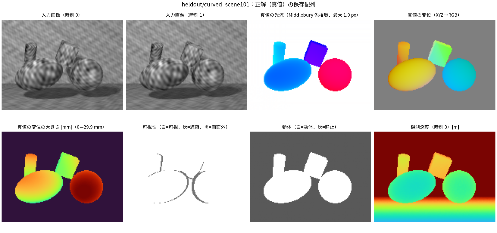
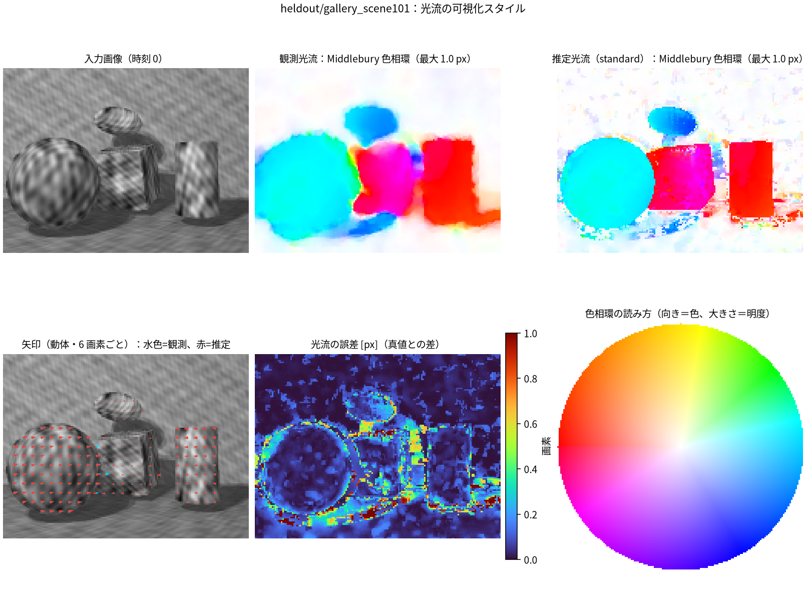
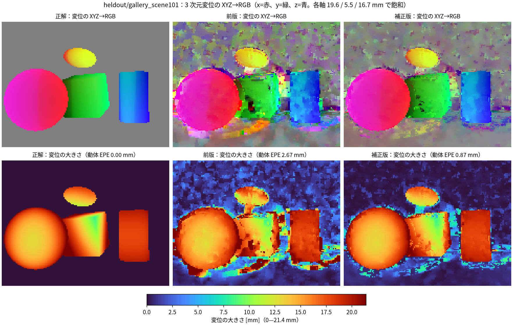
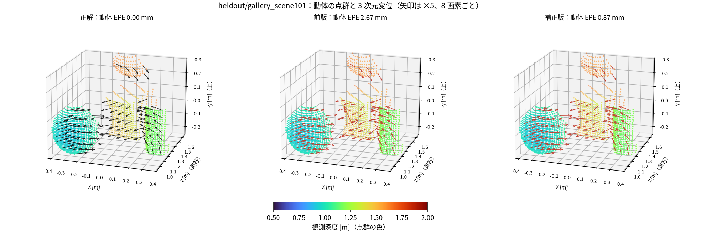
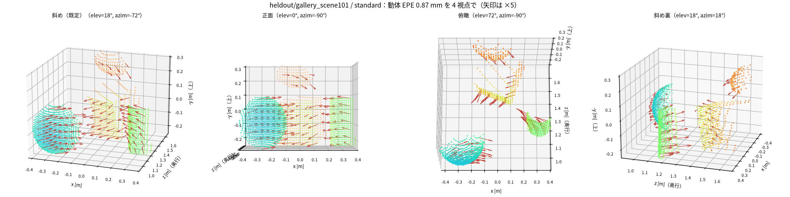
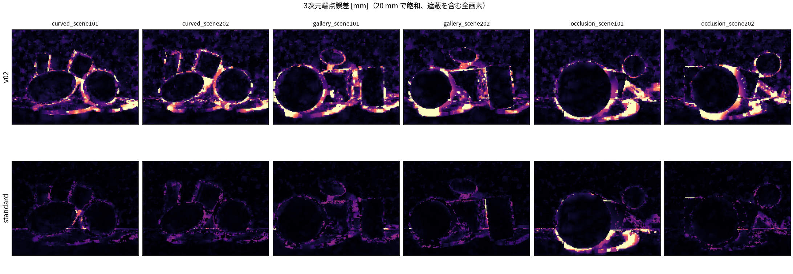
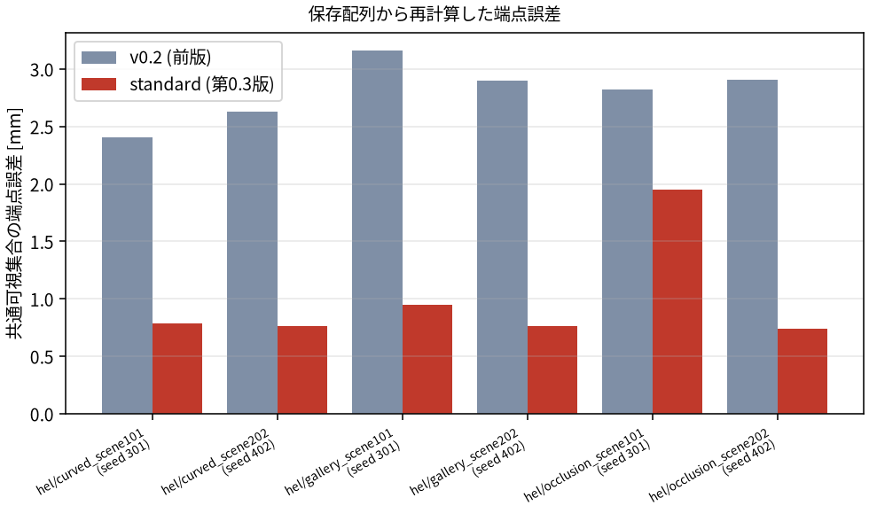
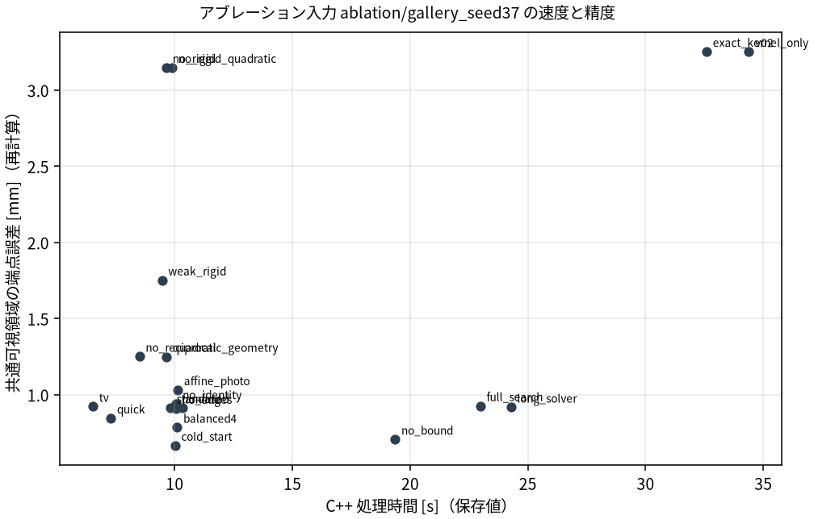

# rgbd_sceneflow_sandbox — RGB-D シーンフロー補正の再現・検証ラボ

配布された一式（保存結果・理論書・実装）を展開し、環境を組み直して
「どこまで実行再現できるか」を検査するラボです。

```
data/                  配布された保存結果（Git 追跡外、`just extract` で復元）
docs/                  理論書（LaTeX と PDF）・表・図・README 用の画像
scene_flow_primitives/ 配布された実装（C++17 コア・Python ラッパ・試験）
src/rgbd_sceneflow/    検証ラボ（保存配列からの再計算・突合・作図）
tests/                 30 件（うち 3 件は配布実装との突き合わせ）
notebooks/             実行済み Notebook（14 節・画像 10 枚を埋め込み）
```

## 使い方

```bash
just extract && uv sync && uv run pytest   # 展開 → 環境 → 30 passed

just reproduce   # 保存結果 70 組を再計算し、凍結メトリクスと突合
just tables      # 集計表の再構成         just figures  # 図の再構成
just notebook    # Notebook を実行        just docs     # 理論書を PDF にビルド
just assets      # README 用の画像を docs/assets/ にそろえる

just build           # 配布実装をビルド
just upstream-test   # 配布実装の自動試験（93 passed）
just verify-upstream # 保存済み推定 1 件を再計算し、配列の一致を確認
```

## 可視化

保存配列だけから描いた図です（`just assets` が `figures/` の出力を `docs/assets/` へ複製）。
Notebook では同じ図をセル内に埋め込んでいます。

**入力と正解** — 画像対・真値の光流（Middlebury 色相環）・真値の変位（XYZ→RGB）・可視性・動体。



**光流の可視化** — 観測と推定を同じ色相環・同じ最大値で並べ、矢印と色相環の読み方も添えます。



**3 次元変位（XYZ→RGB と大きさ）** — 赤=x、緑=y、青=z。0 は中間色で、正負が明暗になります。



**3D ビュー** — 動体の点群（観測深度で着色）と変位ベクトル。左から正解・前版・補正版。



**3D ビュー（4 視点）** — 同じ推定を角度を変えて確認します（ビューアの代わり）。



**誤差** — 入力ごとの端点誤差マップ（20 mm で飽和）と、前版・補正版の対比。







## 再現の結果

| 段階 | 検査 | 結果 |
|---|---|---|
| 実行再現 | `just upstream-test` | **93 passed** |
| 実行再現 | `just verify-upstream` | 保存済み推定の 14 フィールドすべて `max_abs = 0.0` |
| 評価量の再現 | `just reproduce`（70 組） | exact **4,270** / mismatch **0** / 再計算不可 1,055 |

評価量は、評価集合・端点誤差と集合別内訳（動体／静止域／境界／内部／遮蔽／物体別）・
分位点・bad 率・深度 RMSE（全体／観測有効域／欠測域／物体）・支持率・幾何残差・
光学フロー誤差・マッチ再投影ギャップ・移動上限を含みます。定義はアーカイブの数値から
復元したあと配布実装と突き合わせて確定し、`tests/test_upstream.py` が全 70 組を検査します
（最大差 0.0）。処理時間・候補数・固定点残差など推定器内部の量だけは再計算できません。

旧版の実装ツリーは削除済みです（専用の比較スクリプトと互換試験を含む）。旧版の測定値は
検証対象なので保存結果には残っており、主比較の検証はそのまま可能です。

出所：配布記録の環境は Python 3.13.5 / numpy 2.3.5 / scipy 1.17.0 / OpenCV 4.13.0.92、
CPU 単一スレッド（GPU 不使用）。`pyproject.toml` はこの版に合わせています。
数値はすべて人工データに対する測定結果で、実データへの一般化は主張しません。
